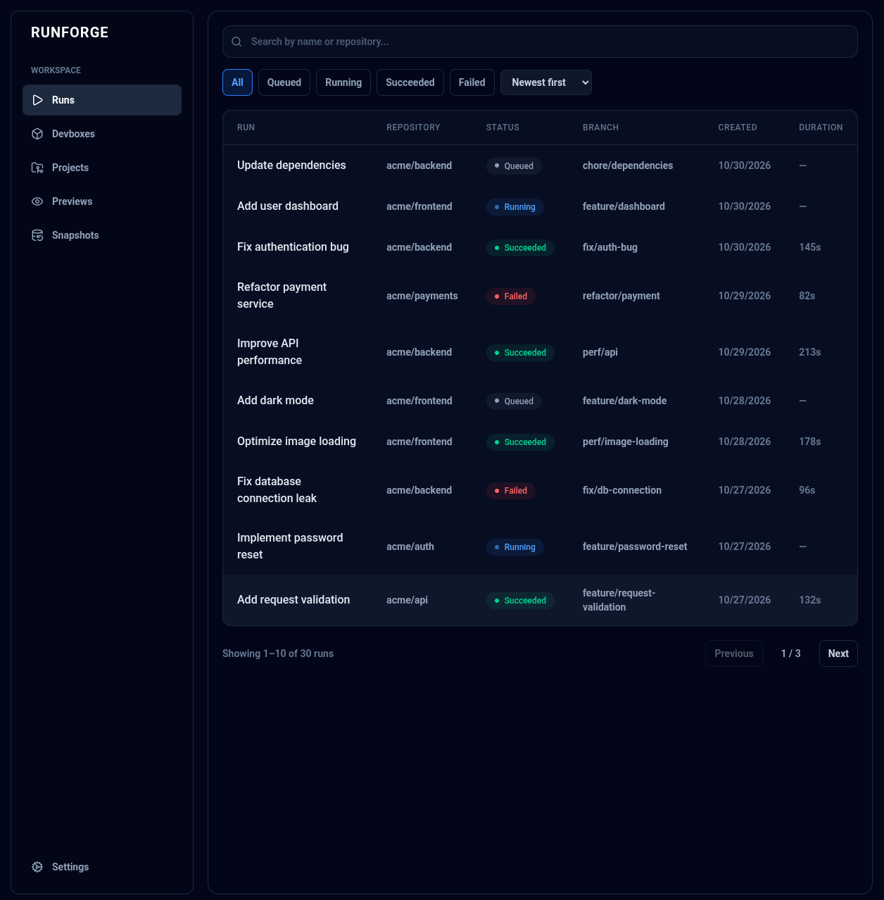
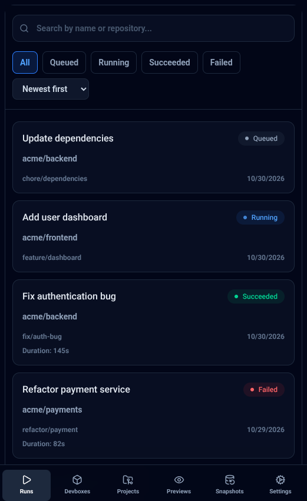
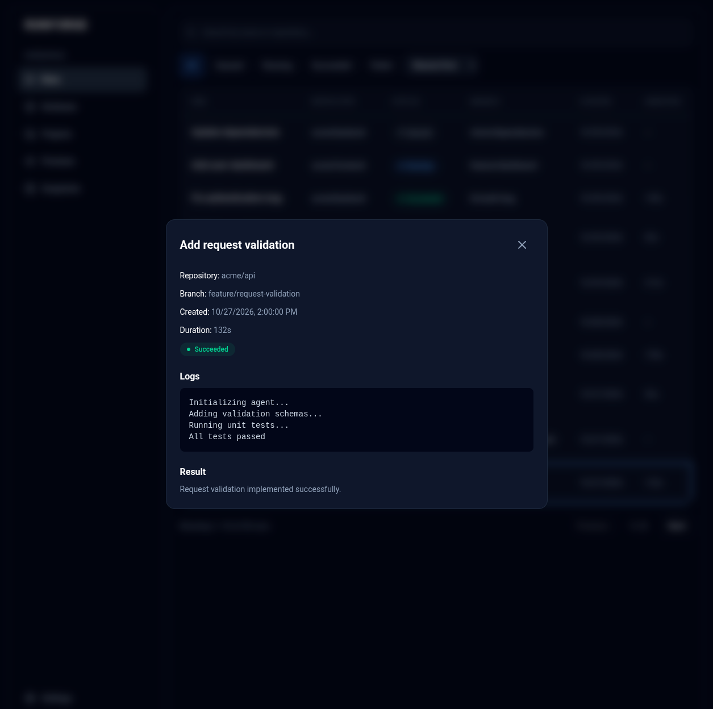

# RunForge


A responsive CI/CD runs dashboard built with React, TypeScript, and Tailwind CSS.

## Overview

RunForge is a frontend application for monitoring and managing CI/CD pipeline runs. It provides a dashboard where users can browse runs, filter them by status, search by name or repository, and inspect detailed execution information.

## Features

- **Runs dashboard** — view pipeline runs with their names, repositories, branches, statuses, creation dates, and durations.
- **Status filtering** — filter runs by Queued, Running, Succeeded, or Failed status.
- **Search** — search runs by name or repository.
- **Sorting** — sort runs by creation date or execution duration.
- **URL state** — search queries, filters, and sorting preferences are synchronized with URL query parameters.
- **Run details** — inspect run information, execution logs, and results.
- **Responsive layout** — adaptive navigation and run list for desktop and mobile screens.
- **Loading and error states** — loading indicators, error handling, retry action, and empty states.

## Tech Stack

- React 19
- TypeScript
- Vite
- Tailwind CSS 4
- Lucide React

## Screenshots

<table>
  <tr>
    <td align="center" width="60%">
      <b>Desktop</b>
    </td>
    <td align="center" width="40%">
      <b>Mobile</b>
    </td>
  </tr>
  <tr>
    <td>
      
    </td>
    <td>
      
    </td>
  </tr>
</table>

<p align="center">
  <b>Run details</b>
  <br>
  
</p>

## Getting Started

### Prerequisites

- Node.js
- npm

### Installation

Clone the repository:

```bash
git clone https://github.com/fndya/runforge-test.git
cd runforge-test
```

Install dependencies:

```bash
npm install
```

Start the development server:

```bash
npm run dev
```

The application will be available at the local URL provided by Vite.

## Available Scripts

| Command | Description |
| --- | --- |
| `npm run dev` | Start the development server |
| `npm run build` | Type-check and build the application |
| `npm run lint` | Run ESLint |
| `npm run preview` | Preview the production build |

## Data

The application currently uses mock data to simulate CI/CD pipeline runs. Run data is provided through a service layer, making it possible to replace the mock implementation with a real API in the future.

## License

This project was created as a frontend test assignment.
