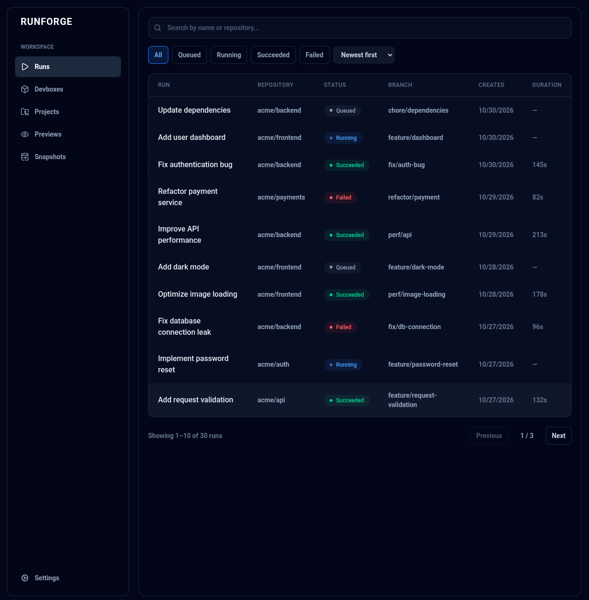
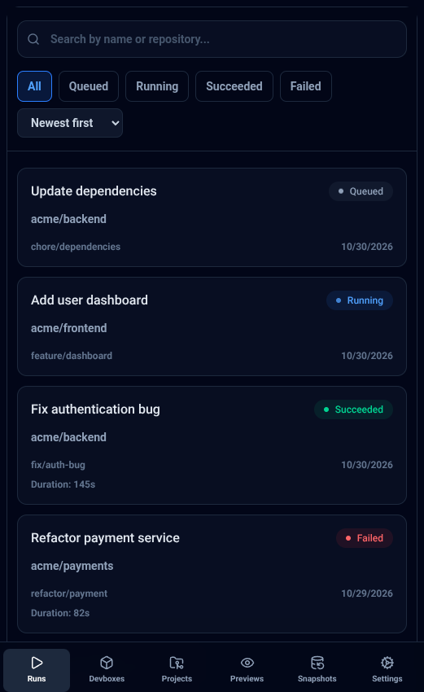
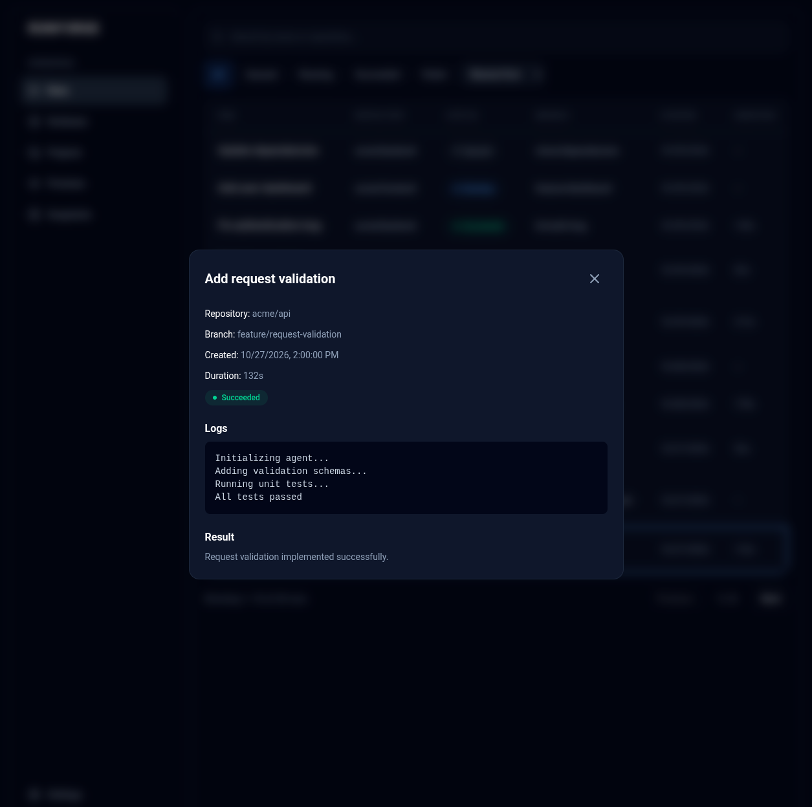

# RunForge

Адаптивная панель мониторинга CI/CD-запусков, созданная с использованием React, TypeScript и Tailwind CSS.
Проект доступен по ссылке: https://fndya.github.io/runforge-test/

## О проекте

RunForge — frontend-приложение для мониторинга и управления запусками CI/CD-пайплайнов. Пользователь может просматривать список запусков, фильтровать их по статусу, искать по названию или репозиторию и изучать подробную информацию о выполнении.

## Возможности

- **Список запусков** — просмотр названия, репозитория, ветки, статуса, даты создания и длительности выполнения.
- **Фильтрация по статусу** — Queued, Running, Succeeded и Failed.
- **Поиск** — поиск по названию запуска или репозиторию.
- **Сортировка** — по дате создания или длительности выполнения.
- **Состояние в URL** — поисковый запрос, фильтры и сортировка синхронизируются с параметрами адресной строки.
- **Детали запуска** — просмотр информации о запуске, логов и результата выполнения.
- **Адаптивный интерфейс** — отдельная компоновка навигации и списка запусков для мобильных устройств и десктопа.
- **Состояния загрузки и ошибок** — индикатор загрузки, обработка ошибок, повторная попытка и отображение пустого результата.

## Технологии

- React 19
- TypeScript
- Vite
- Tailwind CSS 4
- Lucide React

## Скриншоты

<table>
  <tr>
    <td align="center" width="60%">
      <b>Десктопная версия</b>
    </td>
    <td align="center" width="40%">
      <b>Мобильная версия</b>
    </td>
  </tr>
  <tr>
    <td>
      
    </td>
    <td>
      
    </td>
  </tr>
</table>

<p align="center">
  <b>Детали запуска</b>
  <br>
  
</p>

## Запуск проекта

### Требования

- Node.js
- npm

### Установка

Клонируйте репозиторий:

```bash
git clone https://github.com/fndya/runforge-test.git
cd runforge-test
```

Установите зависимости:

```bash
npm install
```

Запустите dev-сервер:

```bash
npm run dev
```

Приложение будет доступно по локальному адресу, который выведет Vite.

## Доступные команды

| Команда | Описание |
| --- | --- |
| `npm run dev` | Запуск dev-сервера |
| `npm run build` | Проверка типов и production-сборка |
| `npm run lint` | Проверка ESLint |
| `npm run preview` | Просмотр production-сборки |

## Данные

На данный момент приложение использует mock data для имитации запусков CI/CD-пайплайнов. Данные загружаются через отдельный сервисный слой, который в дальнейшем можно заменить интеграцией с реальным API.

## Лицензия

Проект создан в рамках тестового задания на frontend-разработчика.